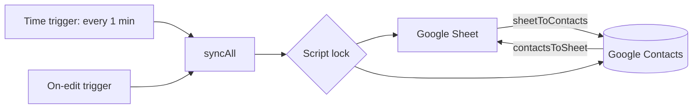

# Sheets-Contacts Sync

Two-way synchronization between Google Sheets and Google Contacts, built with Google Apps Script and the Google People API.


## Overview

This project keeps a Google Sheet and a Google account's contacts in sync without manual intervention.

- A contact added to the Sheet is created in Google Contacts and becomes available on any device signed in with that account.
- A contact added in Google Contacts (for example from a phone) is appended to the Sheet as a new row.

It runs entirely inside the user's Google account. There is no external server, no API key, and no third-party dependency.

## Architecture



### Data model

The Sheet uses three columns:

| Name | Phone | ContactID |
|------|-------|-----------|
| Rahul Test | +919876500001 | people/c12345... |
| Priya Test | +919876500002 | people/c67890... |

`ContactID` holds the People API `resourceName` of the matching contact. It is the only link between a row and a contact.

### Sync logic

`syncAll()` runs both directions in order:

1. **Sheet to Contacts** (`sheetToContacts`): for every row that has a Name and Phone but an empty `ContactID`, a contact is created through the People API and the returned ID is written back to the row.
2. **Contacts to Sheet** (`contactsToSheet`): all contacts are fetched with pagination. Any contact that has a phone number and whose ID is not already present in the Sheet is appended as a new row.

Each side only acts on records the other side does not yet know about, so no record is created twice.

### Why polling

Google Contacts does not provide push notifications or webhooks, so a script cannot be notified when a contact is added on a phone. The script polls every minute, which is the shortest interval Apps Script time-driven triggers allow. An on-edit trigger is added so changes made in the Sheet sync without waiting for the next poll.

## Setup

No deployment is required.

1. **Create the Sheet.** Open [sheets.new](https://sheets.new). Rename the tab to exactly `Contacts`. In row 1 enter `Name`, `Phone`, `ContactID`. Format column B as plain text (Format, Number, Plain text).
2. **Open the script editor.** Go to Extensions, Apps Script.
3. **Add the code.** Replace the default code with the contents of [`Code.gs`](./Code.gs) and save.
4. **Enable the People API.** In the editor sidebar, click `+` next to Services, select People API, and click Add. If the dialog does not open, enable "Show appsscript.json manifest file in editor" under Project Settings and paste the contents of [`appsscript.json`](./appsscript.json) instead.
5. **Create the triggers.** Select `setup` in the function dropdown and click Run. Authorize the requested permissions. Google will show an "unverified app" warning because the script is a personal, unpublished project; choose Advanced, then Go to project, then Allow.
6. **Phone sync (optional).** Add the same Google account on a phone and enable Contacts sync.

`setup()` only needs to run once. It creates a time-driven trigger (every minute) and an on-edit trigger, both calling `syncAll`.

## Testing

**Sheet to Contacts**

1. Add 10 rows with dummy data, leaving `ContactID` empty.
2. Wait up to one minute.
3. Open [contacts.google.com](https://contacts.google.com). All 10 contacts are present and the `ContactID` column is populated.

**Contacts to Sheet**

1. Create an 11th contact in Google Contacts, from the web or a phone.
2. Wait up to one minute.
3. A new row appears in the Sheet, bringing the total from 10 to 11.

## Project structure

```
.
├── Code.gs            Sync logic and trigger setup
├── appsscript.json    Manifest, enables the People API advanced service
└── README.md
```

## Code reference

| Function | Responsibility |
|----------|----------------|
| `setup()` | One-time setup. Removes existing triggers and creates the time-driven and on-edit triggers. |
| `syncAll()` | Trigger entry point. Acquires a script lock, runs both sync directions, releases the lock. |
| `sheetToContacts()` | Creates contacts for rows without a `ContactID` and writes the ID back. Keeps column B as plain text. |
| `contactsToSheet()` | Fetches all contacts via `People.People.Connections.list` (`pageSize` 1000, paginated) and appends unseen ones. |

## Design decisions

- **`ContactID` as the link.** A stored resource name is stable and avoids fuzzy matching on names or phone numbers.
- **Script lock.** The time-driven and on-edit triggers can fire close together. `LockService` ensures only one run executes at a time, which prevents duplicate contacts.
- **Plain-text phone column.** Prevents Sheets from altering values such as a leading `+`.
- **Pagination.** The contact fetch follows `nextPageToken`, so address books larger than one page are handled.

## Limitations

- Contacts to Sheet sync can lag by up to about one minute, because Google Contacts has no push mechanism.
- Only creation is synchronized. Edits and deletions are not propagated in either direction.
- Contacts without a phone number are skipped, and only the first phone number of a contact is used.
- The script is subject to Apps Script daily quotas and trigger runtime limits.

## Roadmap

- Sync edits by comparing `etag` or `updateTime`
- Sync deletions through a soft-delete flag column
- Match on normalized phone numbers for contacts that already exist
- Support multiple phone numbers and email addresses

## Troubleshooting

| Symptom | Cause and fix |
|---------|---------------|
| `Cannot read properties of null (reading 'getLastRow')` | The tab is not named exactly `Contacts`. Rename it. |
| `People is not defined` | The People API service is not enabled. Add it under Services. |
| `Attempted to execute myFunction, but it was deleted` | Select `setup` or `syncAll` in the function dropdown. |
| Nothing syncs | Run `setup` once, then check the Triggers page for two `syncAll` entries and the Executions page for errors. |
| Services dialog does not open | Sign out of other Google accounts, or use the `appsscript.json` manifest approach. |
| Phone numbers lose the `+` | Format column B as plain text. |

## Author

Abhinav ([@abhinavv-13](https://github.com/abhinavv-13))

## License

MIT
